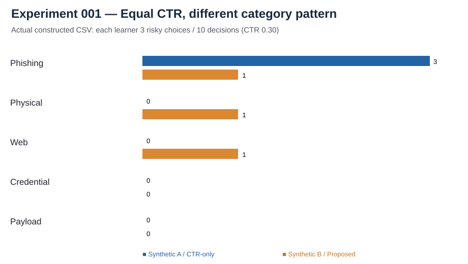

# Human Cyber Risk Research

**Research notes and experiments connected to [VISHWAR](https://vishwar.com).**

A lot of cybersecurity work focuses on whether someone knows the right answer. I am more interested in what happens when that person has to make a decision under pressure, with incomplete information and an attacker trying to influence the environment around them.

That question sits behind my work on VISHWAR, a simulation-based platform for studying human decisions in cybersecurity situations.

I am using this repository to keep the public side of that research in one place: the questions I am exploring, the assumptions I want to test, and any experiments or results that can be shared responsibly.

## What I'm trying to understand

- How does a person's decision change when the surrounding context makes an attack feel credible?
- What can repeated simulation sessions tell us that a single awareness quiz cannot?
- Which signals might help describe human cyber risk without reducing people to one score?
- How should we distinguish an actual improvement in behavior from someone simply remembering a scenario?

These are research questions, not claims that I have already answered them.

## What belongs here

Public research notes, experimental designs, synthetic-data examples, measurement discussions, and documentation of findings once they are ready to share. Some work may lead to code; some may not. I don't want a commit history that suggests progress where there wasn't any.

Start with [the research history](docs/research-history.md), [the research questions](docs/research-questions.md), and [the publishing boundaries](docs/publishing-boundaries.md). The [history workflow](docs/RESEARCH-WORKFLOW.md) explains how earlier work is recorded and checked.

## Literature review (2016–2026)

The [living evidence review](literature-review/README.md) brings together a source matrix, review method, thematic synthesis, and research questions. It is still being expanded, with abstracts distinguished from full-text critical reviews.

## Research notes

- [Three studies on measurement and transfer](research-notes/three-studies-on-measurement.md)

- [From a capstone to a research question](research-notes/from-capstone-to-research.md)
- [What the early pilot can and cannot show](research-notes/what-the-pilot-can-and-cannot-show.md)
- [Measuring a decision without overclaiming](research-notes/measurement-without-overclaiming.md)

## Reading and research watch

I also keep a [literature watch](literature-watch/README.md) for new papers, incident analyses, articles and podcasts connected to the research questions. Assistant-generated interpretations are labelled as drafts until I review them.

## Related literature

[The literature watch](literature-watch/README.md) collects research commentaries on phishing, social engineering, training effectiveness and human decision-making. [Browse the source index](literature-watch/sources.md).

## Relationship to VISHWAR

This is a separate research repository associated with VISHWAR. It is **not** the VISHWAR application source code, a production dependency, or an official release channel. Nothing in this repository should be treated as a complete description of VISHWAR's implementation.

## Updates

Two automated checks run daily: one for documentation issues and another to verify that the published history still matches the recorded milestones. It does not invent research, change files just to create activity, or push to the default branch. Research updates will be added when there is something real to record.

## Contact

For project background, see [vishwar.com](https://vishwar.com).

## New synthetic measurement work (October 2026)

- [Experiment 002 — proposed composite score vs equal CTR](experiments/composite-vs-ctr-synthetic/README.md): reproducible arithmetic sensitivity exercise, not predictive validation.
- [Synthetic staging progress note](research-notes/synthetic-staging-progress-2026-10-11.md): engineering progress, scope and unresolved measurement questions.

## Research visuals

All examples are synthetic; these charts do not establish predictive validity or reveal system implementation.
