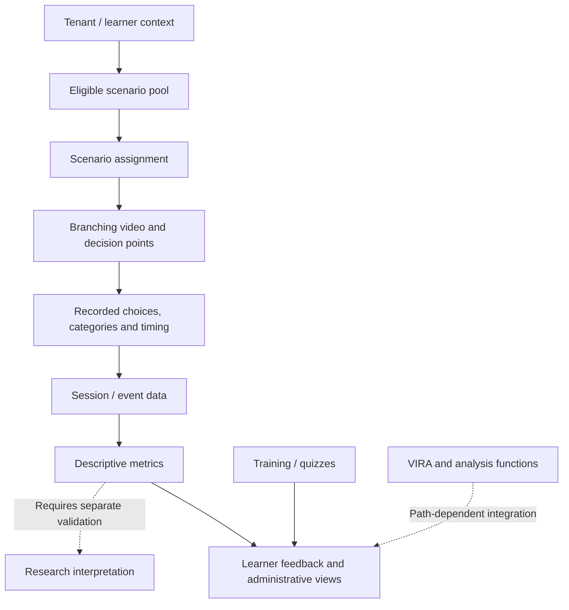

# VISHWAR: architecture and research methodology

**Version:** 1.0 · **Documented:** 2026-10-11  
**Scope:** Public-safe conceptual architecture grounded in the private application source, not a security architecture audit or release certification.

I built VISHWAR around an observation: knowing the right answer in a training module isn't the same thing as making that decision under pressure. The software gives me a way to structure those situations, but a functioning simulator alone does not establish that its metrics measure real-world risk.

## Application and measurement flow

**Source-reviewed integration points (private code):**

- `src/App.tsx`: React Router separates learner, teacher, manager and administrative experiences under protected routes.
- `src/lib/assignStorylines.ts`: tenant-scoped active storyline pools, with school audience filtering and a mock fallback; default assignment count is two.
- `src/hooks/useSimulationEngine.ts`: converts scenes and decision nodes into branching flows; captures decision history and timing, and uses session persistence paths.
- `src/lib/computeModuleMetrics.ts`: generates module event aggregates including risky-choice proportion, reporting events, certain timing values, repeat risky categories and across-category variance.
- `src/lib/computeOverallConsistency.ts`: calculates variance of completed-module CTRs.
- `src/integrations/supabase/` and `supabase/functions/`: backend integration and server-side functions, with full authorization and invocation audit still pending.

These are observed implementation entry points, **not an exported internal architecture**. There may be additional pathways. Some flows use mock fallbacks or switches and should not be characterized as universally active.

## Four levels of evidence

| Level | What it can establish | What it does not establish |
| --- | --- | --- |
| Software implementation | A metric or event pathway exists in reviewed source | Correct deployment, complete instrumentation or valid inference |
| Synthetic tests | Computational correctness and sensitivity to constructed inputs | How real people behave |
| Controlled participant research | Differences under a specific study design and population | Real-world prediction without external validation |
| Field / longitudinal validation | Transfer, stability and operational utility in studied contexts | Universal applicability across populations |

## Measurement and interpretation

A risky-choice rate can be calculated from the fraction of recorded choices labeled risky. Reporting events, time-related measures and category-based repetition can provide complementary descriptions, but they should not be assumed to be interchangeable or independently validated.

In the reviewed `computeModuleMetrics.ts` helper, `risk_score` is **rounded CTR × 100**. This is not evidence that all product views implement the previously proposed multi-factor risk formula. The code's `avg_ttr_seconds` derives from reporting events with positive times less than 300 seconds; our first public synthetic experiment uses **decision time**, which is a different construct. `computeOverallConsistency.ts` calculates variance; the meaning and orientation of a “consistency index” still require explicit definition and tests.

A higher score is not automatically proof of greater real-world loss exposure. Missing events, scene difficulty, category exposure, reporting opportunities and accessibility can confound comparisons.

## Methodology: what I would test

1. **Construct validity.** Define each behavioral quantity, its measurement opportunity, its interpretation and plausible alternative explanations.
2. **Repeatability.** Determine whether repeated simulations reflect stable patterns, learning or remembered storylines.
3. **Transfer.** Compare trained and untrained attack contexts without treating correct recall as generalization.
4. **Difficulty and exposure.** Use matched scenarios, exposure adjustment and sensitivity analyses to avoid confusing hard scenarios with risky learners.
5. **Model calibration.** Compare any forecasts or interventions with transparent baselines, uncertainty estimates and held-out evidence.
6. **Responsible deployment.** Protect participants, minimize identifying event data, validate access controls and avoid punitive individual rankings without adequate evidence.

The public [Experiment 001](../experiments/equal-ctr-different-behavior/README.md) is intentionally small: two constructed learners have the same 30% risky-choice rate but differing distributions. It proves that information is lost in aggregation, **not** that any proposed alternative predicts behavior.

## Research questions

- How does repeated exposure change decision strategies, not simply correctness?
- When does an observed behavior transfer to a different social-engineering setting?
- Which behavioral features add value beyond a baseline risky-choice rate?
- How do organizational context and interfaces alter the decision opportunities available to a learner?
- What amount of evidence is required before an AI recommendation is trustworthy?

## Documentation boundaries

This document omits private data schemas, credentials, internal deployment controls, detailed threat detection logic and patent-sensitive methods. Its basis is source inspection on 2026-10-11, not an assertion that every element is production-enabled. I will update it when the underlying research or validated design changes, while fuller implementation detail remains in the private research lab.
