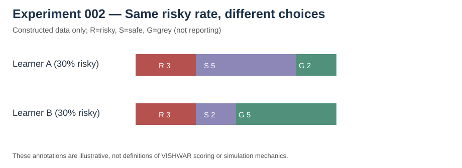
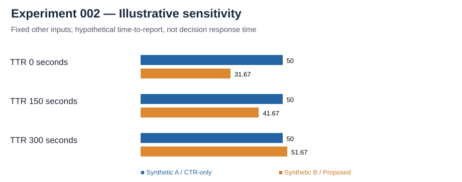

# Experiment 002 — Beyond aggregate risk: decision sequences and context-dependent choices

**Status:** Reproducible synthetic demonstration (11 October 2026). No actual participant observations and no claims about predictive validity.

## Research question

Can two fictional learners produce the same aggregate rate of risky decisions but different **sequences and distributions of other decisions**?

Experiment 001 compared the attack categories in which risk occurred. Experiment 002 instead looks at the *order and nature of choices within an illustrative series of decision opportunities*.

## Decision categories in this exercise

- **R:** risky decision
- **S:** safe decision
- **G:** context-dependent or ambiguous decision, referred to here as a grey choice

These are deliberately simplified **research annotations**, not a specification of VISHWAR's implemented choice labels, scoring rules or branching logic. Grey does **not** mean the participant reported an incident. There is no separate report-button action represented in this exercise.

## Constructed observations

Both fictional learners encounter the same number of opportunities:

| Constructed measure | Learner A | Learner B |
| --- | ---: | ---: |
| Total choices | 10 | 10 |
| Risky (R) | 3 | 3 |
| Safe (S) | 5 | 2 |
| Grey (G) | 2 | 5 |
| Aggregate risky-choice rate | 30% | 30% |
| Adjacent risky-choice pairs | 2 | 0 |

- **A:** R R R S S G S S G S
- **B:** R G S G R G S G R G

The rate alone cannot distinguish their sequences or the frequency of context-dependent responses. Whether any of these differences actually matter for cybersecurity outcomes is **unknown**. An adjacent pair is not proof of habitual behavior or recurring vulnerability.

## Reproduce

```bash
python3 experiments/composite-vs-ctr-synthetic/experiment.py
```

This standard-library-only script constructs the observations and checks the expected counts. It does not require the VISHWAR application, private metrics, credentials or participant data.

## Visual explanations





## Limitations and future research

This is a deterministic counterexample, **not** a study of real learners. R/S/G annotations need an independently justified coding rubric; ambiguous responses can depend on scenario context, and their prevalence should not automatically be interpreted as risk. Adjacent risky decisions also depend on ordering and scenario difficulty.

Future studies should preregister hypotheses, define comparable opportunities, control for scenario order/difficulty, evaluate annotation reliability, and examine whether sequence-level observations predict independent outcomes on ethically collected data.

**Disclosure boundary:** No proprietary score, coefficient, threshold, or implementation mechanism is required to reproduce this public demonstration. Earlier Git history may still contain superseded technical material and is not erased by this revision.
